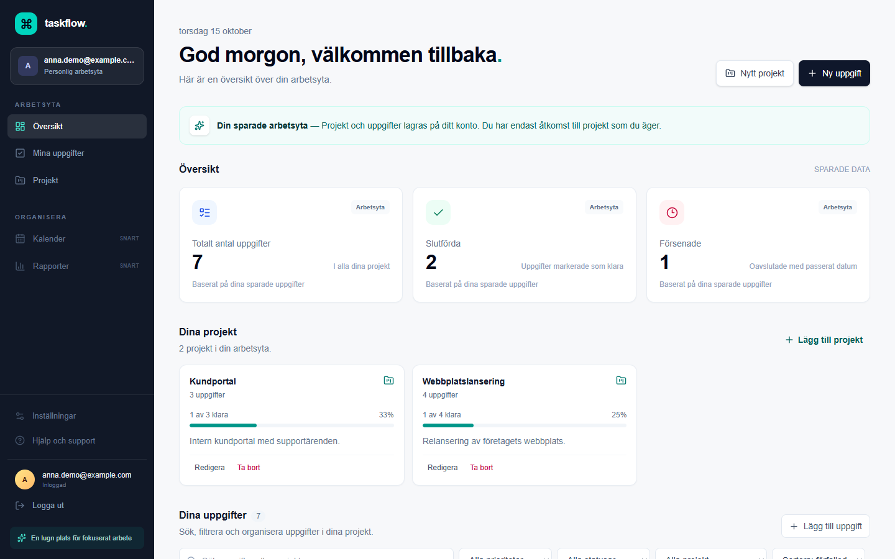
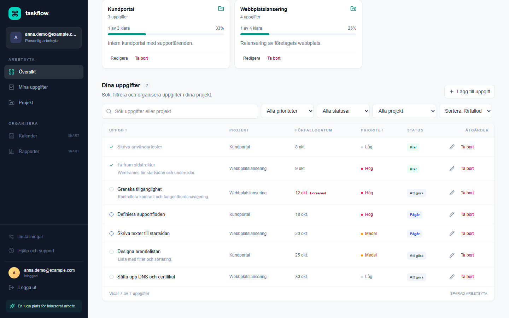
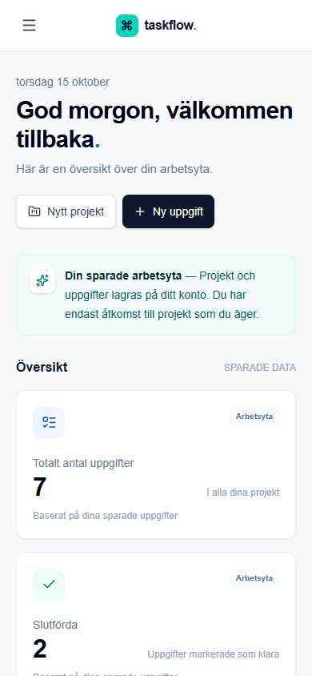
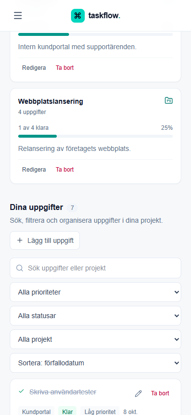

# TaskFlow

TaskFlow är en projekt- och uppgiftshanterare byggd med Next.js App Router,
TypeScript, Tailwind CSS och Supabase. Projektet visar ett sammanhängande
arbetsflöde för att organisera projekt och uppgifter, med autentiseringssidor,
filtrering, sammanfattningar och en responsiv dashboard.

> **Språk:** Användargränssnittet är på svenska.

> **Status:** Funktionerna är implementerade i koden och verifierade med
> automatiska kontroller samt mot en **lokal** Supabase-stack (se
> [Verifieringsstatus](#verifieringsstatus)). Ingen hostad Supabase-miljö är
> verifierad, ingen fjärrmigrering har tillämpats och appen har inte
> publicerats.

## Skärmbilder

Bilderna är tagna i den verkliga appen (produktionsbygge) mot en lokal,
isolerad Supabase-databas med ett syntetiskt testkonto och syntetiska projekt
och uppgifter. Ingen mockad vy har använts och inga skyddsmekanismer har
kringgåtts. Den enda uppgiften om en person som syns är den syntetiska
adressen `anna.demo@example.com` (reserverad exempeldomän) i sidomenyn.

| Vy | Skärmbild |
| --- | --- |
| Dashboard (desktop) |  |
| Projekt och uppgifter (desktop) |  |
| Dashboard (mobil) |  |
| Uppgifter (mobil) |  |

## Funktioner i koden

- E-postregistrering, inloggning, utloggning och skyddad dashboard.
- Skapa, redigera och radera projekt och uppgifter.
- Uppgiftsnamn, beskrivning, status, prioritet, förfallodatum och
  projektkoppling.
- Sökning, filtrering efter projekt/status/prioritet och sortering av
  uppgiftslistan.
- Dashboard-sammanfattningar för totalt antal, färdiga och försenade uppgifter,
  samt projektens beräknade förlopp.
- Responsiv navigering och gränssnitt för desktop och mobil, formulär,
  bekräftelser, väntelägen, tomma lägen och felmeddelanden.
- Zod-validering i autentiserings- och projekt-/uppgiftsflöden.

Att funktionerna finns i koden innebär inte att de har verifierats mot en
ansluten Supabase-tjänst. Kalender, rapporter, inställningar och hjälp är
inaktiva navigationsplatser, inte färdiga funktioner.

## Teknikstack

- **Next.js 16.4.1** med App Router och React 19.
- **TypeScript** med strikt typkontroll.
- **Tailwind CSS 4** för gränssnittsstilar.
- **Supabase Auth** med `@supabase/ssr` och Supabase PostgreSQL.
- **Zod** för indatavalidering.
- **Lucide** för ikoner.
- **Vitest**, React Testing Library och jsdom för automatiska tester.
- **Supabase CLI** och pgTAP-test för lokal databasutveckling.

## Arkitektur i korthet

- `app/` innehåller App Router-sidor, autentiseringscallback, skyddat
  route group, laddningsvy och server actions.
- `components/` innehåller navigering, formulär och dashboardens
  gränssnittskomponenter.
- `lib/auth/` innehåller validering, konfiguration och säkra
  autentiseringsmeddelanden.
- `lib/supabase/` innehåller typer och serverklient. Appens databasfrågor görs
  med den inloggade användarens session.
- `lib/workspace/` innehåller validering, dataläsning och dashboardberäkningar
  för projekt och uppgifter.
- `supabase/migrations/` innehåller den versionshanterade schemamigreringen.
- `supabase/tests/` innehåller pgTAP-tester för schema och RLS-policyer.
- `PRIVACY-POLICY-DRAFT-SV.md` är ett svenskt integritetspolicyutkast som
  behöver kompletteras och granskas före publicering.

## Förutsättningar

- Node.js 20.9 eller senare, vilket är versionskravet för Next.js 16. Använd en
  version som fortfarande stöds för ny utveckling och drift.
- npm.
- En Supabase-instans för att använda autentisering och databasfunktionerna.
- Docker Desktop krävs endast om du vill starta Supabase lokalt och köra lokala
  databastester. Docker behövs inte för lint, typkontroll, Vitest eller
  produktionsbygge.

## Kom igång lokalt

Installera beroenden från låsfilen:

```powershell
npm.cmd ci
```

Kopiera miljövariabelmallen:

```powershell
Copy-Item .env.example .env.local
```

Fyll i `.env.local` med värden från din egen Supabase-instans:

| Variabel | Syfte |
| --- | --- |
| `NEXT_PUBLIC_SUPABASE_URL` | Supabase-projektets API-URL. |
| `NEXT_PUBLIC_SUPABASE_PUBLISHABLE_KEY` | Supabase publishable key. Använd inte en secret- eller service-role-nyckel. |
| `NEXT_PUBLIC_SITE_URL` | Appens ursprung, exempelvis `http://localhost:3000` lokalt. |

`.env.example` innehåller endast platshållare. Lägg aldrig in `.env.local`,
lösenord, service-role-nycklar eller andra hemligheter i Git. Variabler med
prefixet `NEXT_PUBLIC_` är avsedda att vara publika och får inte innehålla
hemligheter.

Starta utvecklingsservern:

```powershell
npm.cmd run dev
```

Öppna sedan `http://localhost:3000`. I PowerShell används `npm.cmd` eftersom
systemets körningspolicy kan blockera `npm.ps1`.

För lokal Supabase-utveckling visar kommandot nedan den lokala API-adressen och
publishable key när tjänsterna startats:

```powershell
npm.cmd run db:start
```

Den befintliga migreringen
[`supabase/migrations/20261014210000_create_projects_and_tasks.sql`](./supabase/migrations/20261014210000_create_projects_and_tasks.sql)
definierar tabellerna `projects` och `tasks`, constraints, index, tidsstämplar,
kaskadradering och RLS-policyer. Läs och granska migreringen innan den används.
`npm.cmd run db:reset` återställer den lokala databasen och tillämpar befintliga
lokala migreringar. Kör det endast när du uttryckligen vill tillämpa migreringar
i en lokal utvecklingsdatabas; det har inte körts som del av
dokumentationsarbetet. Ingen fjärrmigrering har tillämpats eller pushats.

När en lokal databas har startats och migreringarna avsiktligt tillämpats kan
databasschemat och pgTAP-testerna köras med:

```powershell
npm.cmd run db:lint
npm.cmd run db:test
```

Dessa kommandon kräver att den lokala Supabase-miljön är igång. Att migreringen
och testerna finns i repot betyder inte att de har verifierats mot en
hostad databas.

## Utvecklings- och kvalitetskommandon

```powershell
npm.cmd run dev        # Starta utvecklingsservern
npm.cmd run lint       # Kör ESLint
npm.cmd run typecheck  # Kör TypeScript-kontroll utan att skapa byggfiler
npm.cmd test           # Kör Vitest en gång
npm.cmd run build      # Skapa produktionsbygget
npm.cmd start          # Starta det skapade produktionsbygget
npm.cmd audit          # Granska npm-beroenden efter kända sårbarheter
```

### Verifieringsstatus

Kontrollerna nedan kördes i arbetskopian 2026-10-15:

- `npm.cmd run lint` — godkänd.
- `npm.cmd run typecheck` — godkänd.
- `npm.cmd test` — godkänd: 12 testfiler och 52 tester.
- `npm.cmd run build` — godkänd.
- `npm.cmd audit` — 0 kända sårbarheter rapporterade.
- `git diff --check` — godkänd.

Vitest skriver även ut en icke-blockerande varning om Vite-konfigurationens
config loader.

**Lokal Supabase (Docker Desktop, `supabase start`):**

- Migreringen tillämpades automatiskt på den lokala databasen vid start.
- `npm.cmd run db:lint` — inga schemafel.
- `npm.cmd run db:test` — 3 pgTAP-filer, 71 tester, alla godkända. De täcker
  schemabegränsningar, tidsstämplar, främmande nycklar, kaskadradering
  (projekt → uppgifter och användare → projekt → uppgifter), RLS för `anon`,
  ägare och en annan användare (läsa, skapa, ändra, radera), förbud mot att
  överföra ett projekt och mot att flytta en uppgift till en annans projekt.
- Registrering, inloggning, skapande av projekt/uppgifter via gränssnittet och
  skärmbilderna ovan kördes manuellt mot den lokala stacken med ett syntetiskt
  konto.
- Under verifieringen rättades ett fel i testfilen
  `supabase/tests/schema_integrity.test.sql` (en `WITH`-sats med `UPDATE` inuti
  ett uttryck är ogiltig SQL). Migreringen ändrades inte.
- Containern `supabase_vector` startade om i loopen på den här datorn. Den
  används bara för logginsamling och påverkade inte databastesterna.

**Inte verifierat:** hostad Supabase, e-postbekräftelse och
Auth-redirects i en riktig miljö, Vercel-bygge och preview/produktion,
end-to-end-tester (Playwright saknas), tillgänglighet med skärmläsare och
CI (ingen arbetsflödesfil finns).

## Supabase och databas

1. Skapa eller välj en Supabase-instans och konfigurera e-postleverantören i
   Supabase Auth.
2. Använd projektets URL och publishable key i `.env.local`; använd aldrig
   service-role key i appen eller klientkod.
3. Granska den befintliga SQL-migreringen och RLS-policyerna. Den avsedda
   åtkomstmodellen är att projekt ägs av den autentiserade användaren och att
   uppgifter endast är åtkomliga via ett projekt som användaren äger.
4. För lokal utveckling kan Supabase CLI starta en isolerad stack. Kommandot
   `db:reset` tillämpar lokala migreringar och raderar/återskapar den lokala
   databasen; använd det endast när det är avsikten.
5. En fjärrdatabas kräver separat granskning och uttryckligt godkännande av
   målprojekt och migrering. Ingen fjärrmigrering har tillämpats eller pushats
   här.

**Viktigt:** kodgranskning och mockade tester är inte bevis på säkerhet i en
ansluten miljö. Testa autentisering, dataåtkomst och isolering mellan separata
testanvändare mot den avsedda Supabase-instansen innan riktiga användare eller
produktionsdata används.

## Förberedelser för framtida publicering

Appen är inte publicerad och ingen Vercel-konfiguration har verifierats. Se den
fullständiga svenska checklistan i
[`docs/RELEASE-CHECKLIST-SV.md`](./docs/RELEASE-CHECKLIST-SV.md). Sammanfattning: Inför
en framtida driftsättning behöver ägaren:

1. Granska migrationen och fastställa en separat, säker process för att
   tillämpa den på rätt Supabase-projekt.
2. Importera repot som ett Next.js-projekt i Vercel och verifiera att vald
   Node.js-version stöds av Next.js 16.
3. Konfigurera `NEXT_PUBLIC_SUPABASE_URL`,
   `NEXT_PUBLIC_SUPABASE_PUBLISHABLE_KEY` och `NEXT_PUBLIC_SITE_URL` i rätt
   Vercel-miljö. De två första värdena exponeras som publika klientvärden.
4. Aktivera åtkomst till Vercels systemvariabler för Preview-miljöer. Koden
   använder `VERCEL_URL` och `VERCEL_ENV` för callback-adressen vid
   Preview-registrering; dessa värden ska inte läggas till som hemligheter i
   `.env.example`.
5. I Supabase Auth URL Configuration ange appens Site URL och tillåt callbacken
   `/auth/callback` för produktionsdomänen. Lägg till lokal callback för
   utveckling och konfigurera vid behov en snävt avgränsad Preview-regel.
6. Efter driftsättning manuellt testa registrering, e-postbekräftelse,
   inloggning, utloggning, skyddade sidor, CRUD och åtkomstisolering med
   separata testkonton och icke-produktionsdata.

Exakta domäner och autentiseringsinställningar beror på den miljö som ägaren
väljer och har inte konfigurerats eller testats här. Ändra inte
Supabase-projektets inställningar eller tillämpa fjärrmigreringar utan separat
granskning.

## Säkerhet och integritet

- Autentiserade läsningar och ändringar använder Supabase-serverklienten och
  användarens session. Server actions validerar indata med Zod och härleder
  identiteten från autentiserad session.
- Migreringen definierar separata RLS-policyer för projekt och deras uppgifter,
  inklusive kontroller av ägarskap för operationerna.
- `.env.local` ignoreras av Git; `.env.example` innehåller endast
  platshållarvärden. Appen använder inte en service-role key i klientkod.
- Svarshuvuden `X-Content-Type-Options`, `X-Frame-Options`,
  `Referrer-Policy` och `Permissions-Policy` sätts i `next.config.ts` (testat
  och kontrollerat med `curl` mot produktionsbygget). Ingen Content Security
  Policy är införd; det är framtida arbete.
- Supabase-sessioncookies används för kärnfunktionalitet. Analys eller
  icke-nödvändig spårning har inte lagts till.
- Projekt- och uppgiftsradering finns. Självbetjänad kontoradering och komplett
  dataexport är däremot inte implementerade.
- [Svenskt utkast till integritetspolicy](./PRIVACY-POLICY-DRAFT-SV.md) är
  ofullständigt och inte redo att publiceras. Det fastställer inte
  GDPR-efterlevnad.

**Status för verifiering:** RLS och schema är verifierade mot en lokal
Supabase-stack (pgTAP) men inte mot en hostad miljö. Ingen fjärrmigrering har
tillämpats. Applikationen har inte publicerats. Innan riktiga personuppgifter tas emot måste
ägaren komplettera policyutkastet, fastställa laglig grund och lagringstider,
granska personuppgiftsbiträdesavtal, underbiträden, regioner och
överföringsarrangemang samt ta fram fungerande processer för registrerades
begäranden och incidenthantering. Detta är inte juridisk rådgivning.

## Tekniska beslut och verifierbara styrkor

- **Servergräns för känsliga operationer:** Supabase-klienten för dataåtkomst
  ligger på serversidan, och identitet hämtas genom Supabase Auth-sessionen
  i stället för från ett användar-ID i formuläret.
- **Flera åtkomstlager:** server actions kontrollerar session och relevanta
  ägarskap; databasmigreringen definierar RLS som en separat
  åtkomstkontroll. Detta beskriver koden, inte verifierad driftssäkerhet.
- **Dataintegritet i schema:** migrationen definierar främmande nycklar,
  constraints, index, tidsstämplar och kaskad från projekt till uppgifter.
- **Validering nära indata:** Zod-scheman används av autentiserings- och
  workspace-flöden, och komponenter ger fel- och väntetillstånd.
- **Testbar domänlogik:** dashboardens beräkningar för sammanfattningar,
  filtrering, sortering och projektförlopp har separata tester.
- **Begränsad beroendemängd:** projektet använder den befintliga stacken för
  formulär, validering, ikoner och tester i stället för att införa en ny
  applikationsarkitektur för denna presentation.

## Roadmap

### Implementerat i koden

- Responsiv projekt- och uppgiftshantering med autentiseringssidor.
- Filtrering, sortering, sammanfattningar, formulärvalidering och
  användarfeedback.
- Supabase-migrering och RLS-policyer med tillhörande lokala pgTAP-tester.
- Enhets- och komponenttester utan krav på riktiga kontouppgifter.

Implementerat betyder inte att live-tjänster eller produktionskonfiguration har
verifierats.

### Återstår före produktionsanvändning

- Konfigurera en Supabase-instans, granska och tillämpa migreringen genom en
  kontrollerad process, och verifiera Auth, CRUD och RLS med isolerade
  testkonton.
- Köra de lokala databastesterna i CI (de har körts manuellt lokalt).
- Konfigurera och manuellt verifiera Vercel, miljövariabler och
  autentiseringscallbackar.
- Komplettera och granska integritetspolicyn samt fastställa processer för
  dataexport, kontoradering, lagring och incidenter.
- Lägga till end-to-end-tester för viktiga användarflöden.

### Möjliga framtida förbättringar

- Självbetjäning för export och kontoradering efter säkerhets- och
  datalivscykelgranskning.
- Playwright-flöden för autentisering och CRUD mot en isolerad testmiljö.
- Färdigställa kalender-, rapport- och inställningsfunktioner om de behövs.
- CI-arbetsflöde som kör lint, typkontroll, tester och bygge.

## Kända begränsningar

- Live Supabase Auth mot en hostad miljö samt hostad databasåtkomst och RLS är
  inte verifierade (lokal stack är verifierad, se Verifieringsstatus).
- Automatiska applikationstester använder mocks för Supabase-beroende
  beteenden; pgTAP-testerna körs manuellt lokalt och inte i CI.
- Kontoexport, kontoradering, lösenordsåterställning, OAuth och
  flerfaktorsautentisering finns inte.
- Kalender, rapporter, inställningar och hjälp är inte implementerade.
- Ingen Playwright-baserad end-to-end-svit, CI-konfiguration eller
  produktionsdriftsättning har verifierats.
- Integritetspolicyn är ett ofullständigt utkast och utgör inte ett påstående om
  GDPR-efterlevnad.
